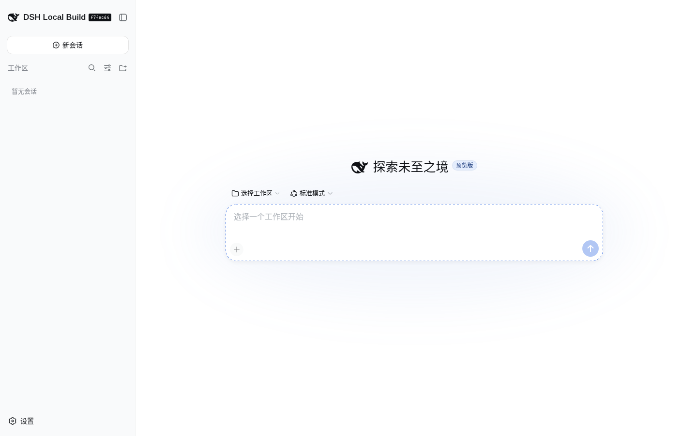

> **说明 / Note.** 本仓库是 DeepSeek Harness 的公开 fork，上游文档结构保持原样。安全问题请按 [SECURITY.md](SECURITY.md) 私下报告。
>
> This repository is a public fork of DeepSeek Harness. The upstream README below is kept as-is. Please report vulnerabilities via [SECURITY.md](SECURITY.md).
>
> **本 fork 的安装包与截图 / Packages and screenshots on this fork.**
> 本仓库（`gatesenman/deepseek-harness`）在 `v0.1.0` 发布了下列资产，文件名带有 `Ontology-Studio`，**不是**上游 DeepSeek Harness 的官方安装包，也不能当成 dsh 桌面发行版：
> `DeepSeek-Harness-Ontology-Studio-Setup-0.1.0-win-x64.exe`、
> `DeepSeek-Harness-Ontology-Studio-0.1.0-win-x64.zip`、
> `DeepSeek-Harness-Ontology-Studio-0.1.0-linux-x86_64.AppImage`。
> 中文 README 里的企微助手 / 入群问卷 / 微信公众号配图是社区二维码，不算产品界面。
> 下面两张是上游文档里已经存在、并经目视确认的「模型 / Models」设置页（API 密钥输入框为空，画面中没有密钥值；不是本 fork Windows 安装后的截图）。
>
> This fork published the `v0.1.0` assets named above. They are Ontology-Studio-branded and are **not** official upstream DeepSeek Harness installers. The WeCom / WeChat QR images in the Chinese README are community links, not product UI. The two shots below are upstream docs captures of the Models settings page (empty API key field, no secret values visible). They are not post-Windows-install captures of this fork.
>
> | Models settings (docs, English) | 模型设置（文档，中文） |
> | --- | --- |
> |  |  |
>
> 另外两张来自同一 `docs/bilingual-readme` 分支、已目视确认的 Web UI 首页（标题为 DSH Local Build / 预览版，不是本 fork Windows 安装后的截图）。
>
> Two more visually confirmed Web UI home shots from the same branch (title "DSH Local Build", preview build; not post-Windows-install captures of this fork):
>
> | Web UI 首页（中文） | Web UI home (English) |
> | --- | --- |
> |  |  |


# DeepSeek Harness

English | [中文](README.zh.md)

DeepSeek Harness (`dsh`) is an open-source agent harness developed by [DeepSeek AI](https://deepseek.com).

It uses an architecture where **everything is a plugin**, and is powered by [Cordis](https://github.com/cordiverse/cordis), whose design is described in [_A Programming Paradigm for Spatiotemporal Composability_](https://github.com/cordiverse/paper).

## Developer preview

DeepSeek Harness is currently in _developer preview_ and is iterating rapidly. **THERE WILL BE COMPATIBILITY-BREAKING CHANGES.**

## Run

### Run from `npm`

Install `Node.js`, then run:

```sh
npx @deepseek-ai/dsh web
```

The command starts the Web UI at `http://127.0.0.1:3080` by default and opens it in the default browser for a local launch. An SSH launch only prints the host URL because the SSH client or editor owns the local forwarded address. Pass `--no-open` to run the server without opening a browser. See [Web UI guide](docs/user/guide/index.md).

### Run from source

To run from a repository checkout:

```sh
git clone https://github.com/deepseek-ai/deepseek-harness.git
cd deepseek-harness
pnpm install
pnpm run build
pnpm dsh web
```

`pnpm run build` prepares the repository artifacts. `pnpm dsh web` uses those built artifacts without rebuilding.

## Community and support

- Feel free to submit feedback or bug reports through [GitHub Discussions](https://github.com/deepseek-ai/deepseek-harness/discussions).
- Add the [`dsh-plugin`](https://github.com/topics/dsh-plugin) topic to your plugin repository for discoverability.
- Join <a href="https://discord.gg/Ycq5dCaS4">DeepSeek Harness Discord community</a>.

## Contributing

See [CONTRIBUTING.md](CONTRIBUTING.md).

## Development

Start with the [development guide](docs/development.md) and [architecture documentation](docs/architecture.md).

For agents, follow [AGENTS.md](AGENTS.md).

## License

[MIT](LICENSE)

Third-party dependencies and their licenses are disclosed in [THIRD_PARTY_NOTICES.md](THIRD_PARTY_NOTICES.md).
