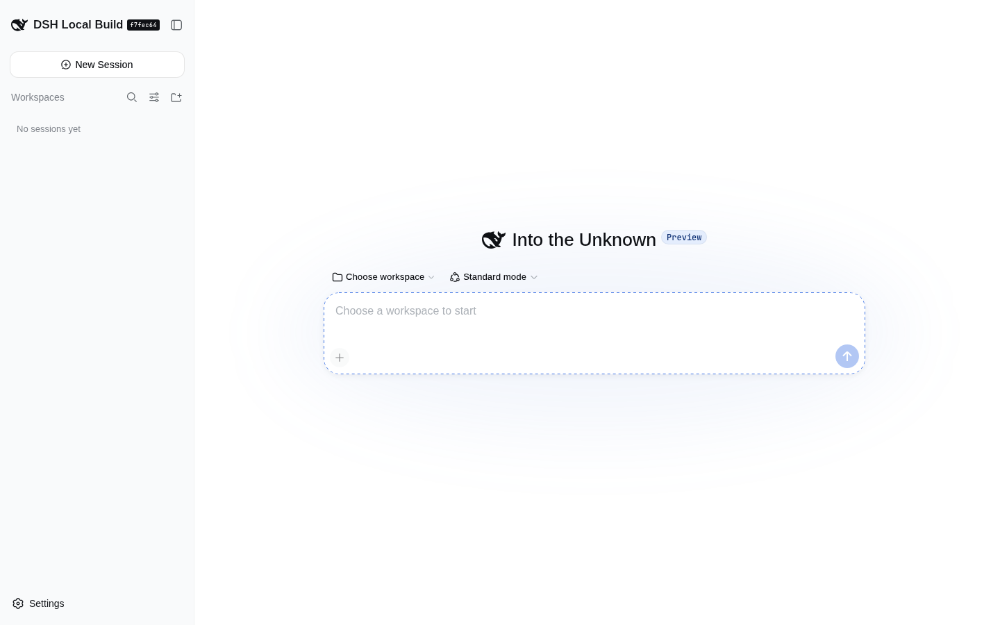
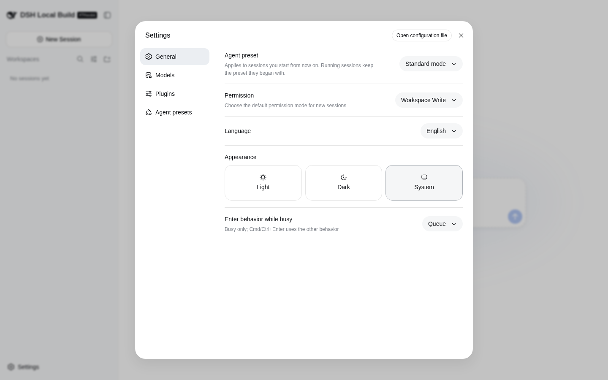
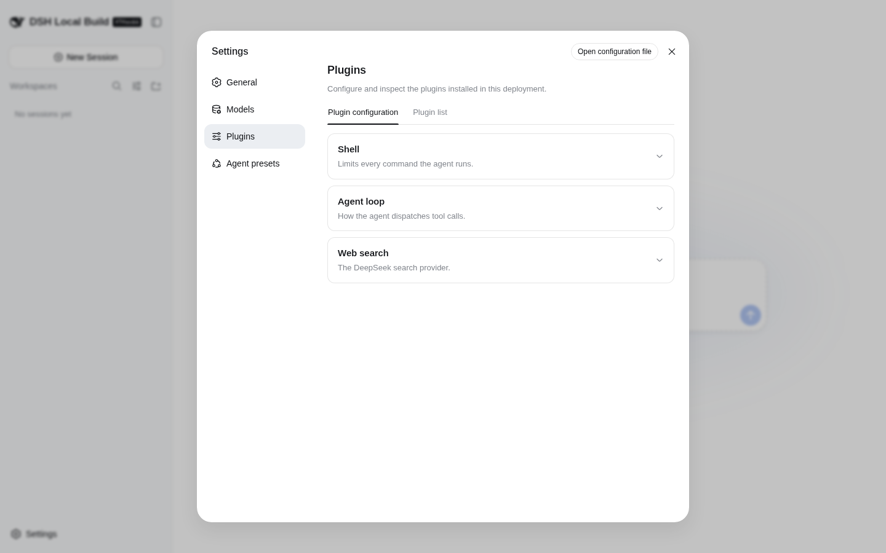
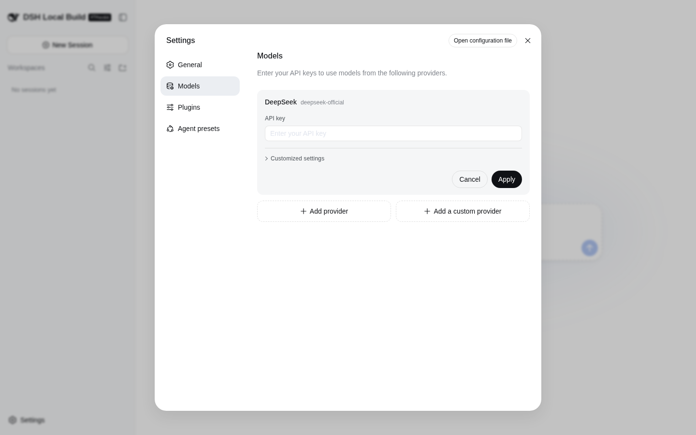

# DeepSeek Harness

English | [中文](README.zh.md)

DeepSeek Harness (`dsh`) is an open-source agent harness developed by [DeepSeek AI](https://deepseek.com).

It uses an architecture where **everything is a plugin**, and is powered by [Cordis](https://github.com/cordiverse/cordis), whose design is described in [_A Programming Paradigm for Spatiotemporal Composability_](https://github.com/cordiverse/paper).

## Developer preview

DeepSeek Harness is currently in _developer preview_ and is iterating rapidly. **THERE WILL BE COMPATIBILITY-BREAKING CHANGES.**

## Features

- **Everything is a plugin**: the agent loop, tools, model providers, storage, sandbox and UI are all [Cordis](https://github.com/cordiverse/cordis) plugins composed into *profiles* (`web`, `headless`, or your own) under `$DSH_HOME/profiles/<name>`.
- **Web UI** (`dsh web`): sessions per workspace, model and plugin settings, agent presets, permission modes, light / dark theme, English and Chinese.
- **Coding agent**: reads and edits workspace files, runs commands, delegates work to sub-agents and maintains a plan; operations that need approval under the active permission policy are confirmed in the UI.
- **Headless mode**: `dsh --profile headless "job"` runs one persisted session, prints the final answer and exits.
- **Model providers**: the official DeepSeek provider plus other providers and custom OpenAI-compatible endpoints ([model configuration guide](docs/user/guide/providers.md)).
- **Integrations**: ACP, MCP, skills, LSP, E2B and local sandboxes, a [Python SDK](docs/user/guide/python-sdk.md).

## Screenshots

Captured from a local `pnpm dsh web` build of this repository (no API key configured):

| Home | Settings → General |
| --- | --- |
|  |  |
| **Settings → Plugins** | **Settings → Models** |
|  |  |

## Run

### Run from `npm`

Install `Node.js`, then run:

```sh
npx @deepseek-ai/dsh web
```

The command starts the Web UI at `http://127.0.0.1:3080` by default and opens it in the default browser for a local launch. An SSH launch only prints the host URL because the SSH client or editor owns the local forwarded address. Pass `--no-open` to run the server without opening a browser. See [Web UI guide](docs/user/guide/index.md).

### Run from source

To run from a repository checkout:

```sh
git clone https://github.com/deepseek-ai/deepseek-harness.git
cd deepseek-harness
pnpm install
pnpm run build
pnpm dsh web
```

`pnpm run build` prepares the repository artifacts. `pnpm dsh web` uses those built artifacts without rebuilding.

## Configuration

- **Model**: open **Settings → Models** in the Web UI and enter a [DeepSeek API key](https://platform.deepseek.com/); other providers and custom endpoints are covered in the [model configuration guide](docs/user/guide/providers.md).
- **Home directory**: `$DSH_HOME` (default `~/.dsh`) holds `settings.yaml`, `.credentials.yaml` (API keys, write-only from the UI), `profiles/<name>/` and the machine-wide patch layer `cordis.patch.yml`.
- **Web server flags**: `dsh web --host <host> --port <port> --no-open --trusted-host <authority>`; run `dsh web --help` for the full list.
- **Plugin config**: every `config:` key a plugin accepts is listed in the generated [plugin config catalog](docs/config-catalog.md).

## Tech stack

TypeScript on Node.js (`^22.19.0 || >=24.0.0`), pnpm workspaces, [Cordis](https://github.com/cordiverse/cordis) plugin runtime, React 19 + Vite for the Web UI, tsdown / tsc builds, Vitest and Playwright tests, oxlint, plus a Python SDK and a native Landlock sandbox helper.

## Project structure

| Path | Contents |
| --- | --- |
| `apps/cli/` | the `dsh` launcher (profiles, web / headless modes) |
| `apps/web/` | Web UI front end |
| `packages/` | harness plugins grouped by subsystem (core, llm, session, shell, sandbox, mcp, acp, web, …) |
| `python/` | Python SDK |
| `native/` | native helpers (landlock-run) |
| `vendor/` | pinned upstream Cordis plugins |
| `docs/` | architecture, subsystem references, user and developer guides |
| `scripts/` | build, lint, verification and doc generators |
| `website/` | documentation site |

## Community and support

- Feel free to submit feedback or bug reports through [GitHub Discussions](https://github.com/deepseek-ai/deepseek-harness/discussions).
- Add the [`dsh-plugin`](https://github.com/topics/dsh-plugin) topic to your plugin repository for discoverability.
- Join <a href="https://discord.gg/Ycq5dCaS4">DeepSeek Harness Discord community</a>.

## Contributing

See [CONTRIBUTING.md](CONTRIBUTING.md).

## Development

Start with the [development guide](docs/development.md) and [architecture documentation](docs/architecture.md).

For agents, follow [AGENTS.md](AGENTS.md).

## License

[MIT](LICENSE)

Third-party dependencies and their licenses are disclosed in [THIRD_PARTY_NOTICES.md](THIRD_PARTY_NOTICES.md).
