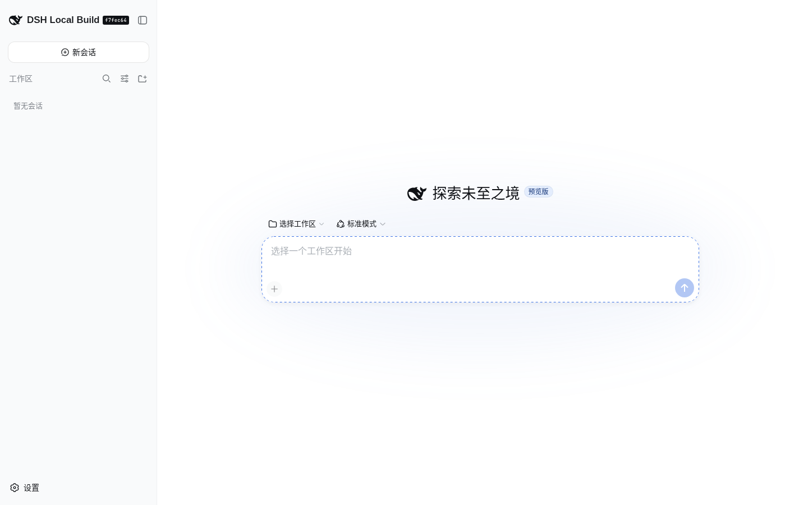
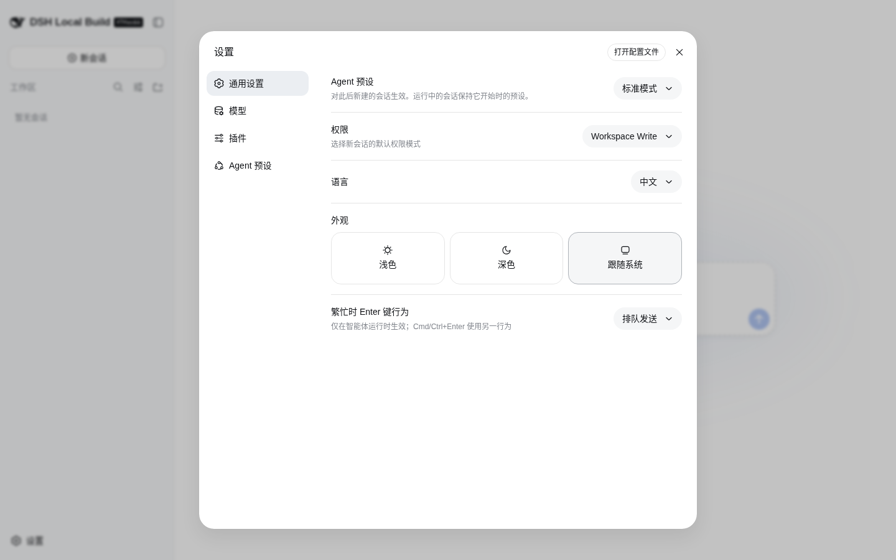
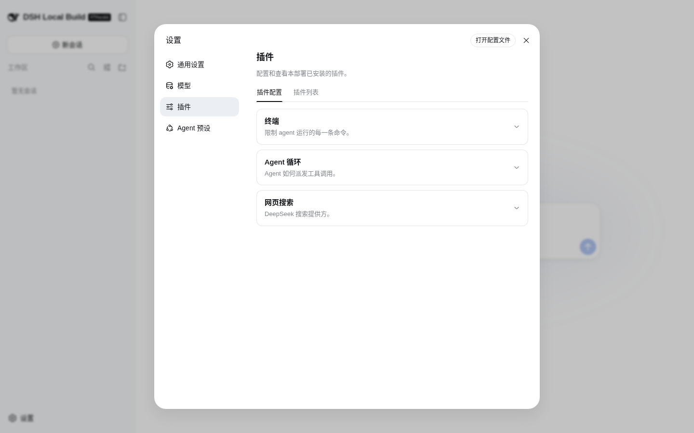
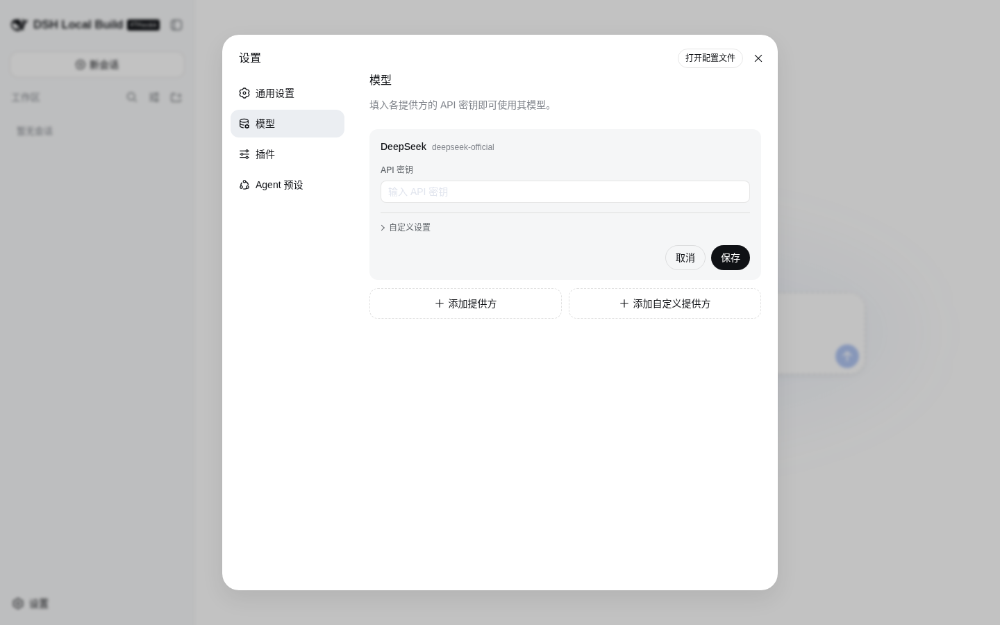

# DeepSeek Harness

[English](README.md) | 中文

DeepSeek Harness（`dsh`）是由 [DeepSeek AI](https://deepseek.com) 开发的开源 agent harness（智能体框架）。

它采用**一切皆插件**的架构，并由 [Cordis](https://github.com/cordiverse/cordis) 驱动，其设计参见论文 [_A Programming Paradigm for Spatiotemporal Composability_](https://github.com/cordiverse/paper)。

## 开发者预览

DeepSeek Harness 目前处于 _开发者预览_ 阶段，正在快速迭代。**未来将出现破坏兼容性的变更。**

## 功能特性

- **一切皆插件**：智能体循环、工具、模型提供方、存储、沙箱和界面都是 [Cordis](https://github.com/cordiverse/cordis) 插件，组合成位于 `$DSH_HOME/profiles/<name>` 的 *profile*（`web`、`headless` 或你自己的）。
- **Web UI**（`dsh web`）：按工作区管理会话，模型与插件设置、Agent 预设、权限模式、浅色 / 深色主题，支持中英文。
- **编码智能体**：读取和编辑工作区文件、运行命令、把工作委派给子智能体并维护计划；在当前权限策略下需要审批的操作会在界面中确认。
- **无界面模式**：`dsh --profile headless "任务"` 运行一个持久化会话，打印最终回答后退出。
- **模型提供方**：DeepSeek 官方提供方，以及其他提供方和自定义 OpenAI 兼容端点（见 [模型配置指南](docs/user/guide/providers.zh.md)）。
- **集成**：ACP、MCP、技能（skills）、LSP、E2B 与本地沙箱、[Python SDK](docs/user/guide/python-sdk.zh.md)。

## 界面截图

以下截图来自本仓库本地构建后运行的 `pnpm dsh web`（未配置 API Key）：

| 首页 | 设置 → 通用设置 |
| --- | --- |
|  |  |
| **设置 → 插件** | **设置 → 模型** |
|  |  |

<a id="run"></a>

## 运行

### 通过 `npm` 运行

安装 `Node.js`，然后运行：

```sh
npx @deepseek-ai/dsh web
```

该命令默认会在 `http://127.0.0.1:3080` 启动 Web UI，本机启动时还会用默认浏览器打开页面。通过 SSH 启动时只打印宿主机 URL，因为本地转发地址由 SSH 客户端或编辑器持有。传入 `--no-open` 可仅运行服务器而不打开浏览器。详见 [Web UI 指南](docs/user/guide/index.zh.md)。

<a id="run-from-source"></a>

### 从源码运行

如需从仓库源码运行：

```sh
git clone https://github.com/deepseek-ai/deepseek-harness.git
cd deepseek-harness
pnpm install
pnpm run build
pnpm dsh web
```

`pnpm run build` 会准备仓库产物。`pnpm dsh web` 会直接使用这些已构建产物，不会重新构建。

## 配置

- **模型**：在 Web UI 中打开 **设置 → 模型**，填入 [DeepSeek API Key](https://platform.deepseek.com/)；其他提供方和自定义端点见 [模型配置指南](docs/user/guide/providers.zh.md)。
- **主目录**：`$DSH_HOME`（默认 `~/.dsh`）保存 `settings.yaml`、`.credentials.yaml`（API 密钥，界面中只写不读）、`profiles/<name>/` 以及全机共享的补丁层 `cordis.patch.yml`。
- **Web 服务参数**：`dsh web --host <host> --port <port> --no-open --trusted-host <authority>`；完整列表见 `dsh web --help`。
- **插件配置**：每个插件可接受的 `config:` 键都列在自动生成的 [插件配置目录](docs/config-catalog.zh.md) 中。

## 技术栈

TypeScript + Node.js（`^22.19.0 || >=24.0.0`）、pnpm workspaces、[Cordis](https://github.com/cordiverse/cordis) 插件运行时、React 19 + Vite（Web UI）、tsdown / tsc 构建、Vitest 与 Playwright 测试、oxlint，另有 Python SDK 和原生 Landlock 沙箱辅助程序。

## 项目结构

| 路径 | 内容 |
| --- | --- |
| `apps/cli/` | `dsh` 启动器（profile、web / headless 模式） |
| `apps/web/` | Web UI 前端 |
| `packages/` | 按子系统分组的 harness 插件（core、llm、session、shell、sandbox、mcp、acp、web 等） |
| `python/` | Python SDK |
| `native/` | 原生辅助程序（landlock-run） |
| `vendor/` | 固定版本的上游 Cordis 插件 |
| `docs/` | 架构、子系统参考、用户与开发者指南 |
| `scripts/` | 构建、lint、校验与文档生成脚本 |
| `website/` | 文档站点 |

## 社区与支持

- 欢迎通过 [GitHub Discussions](https://github.com/deepseek-ai/deepseek-harness/discussions) 提交反馈或 bug 报告。
- 为你的插件仓库添加 [`dsh-plugin`](https://github.com/topics/dsh-plugin) 话题，便于被发现。
- 欢迎加入 DeepSeek Harness 企微群：扫码添加企微小助手并填写入群问卷，完成后小助手会邀请你入群。

<table>
  <thead>
    <tr>
      <th align="center">企微小助手</th>
      <th align="center">入群问卷</th>
      <th align="center">微信公众号</th>
    </tr>
  </thead>
  <tbody>
    <tr>
      <td align="center"></td>
      <td align="center"><a href="https://trtgsjkv6r.feishu.cn/share/base/form/shrcnIt5twSVdLGD52KJBckGCgg"></a></td>
      <td align="center"></td>
    </tr>
  </tbody>
</table>

## 参与贡献

参见 [CONTRIBUTING.md](CONTRIBUTING.zh.md)。

## 开发

请先阅读[开发指南](docs/development.zh.md)与[架构文档](docs/architecture.zh.md)。

面向 agent：请遵循 [AGENTS.md](AGENTS.md)。

## 许可证

[MIT](LICENSE)

第三方依赖及其许可证见 [THIRD_PARTY_NOTICES.md](THIRD_PARTY_NOTICES.md)。
